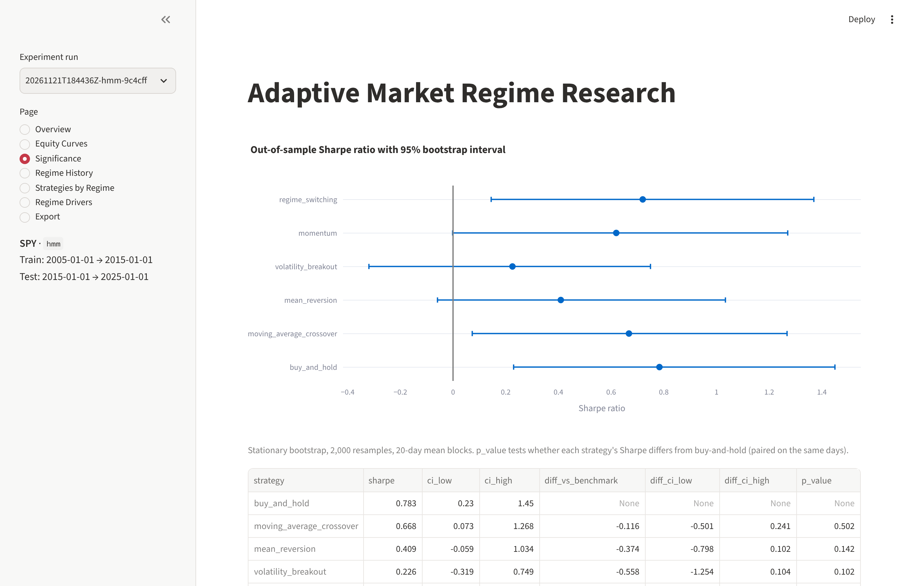
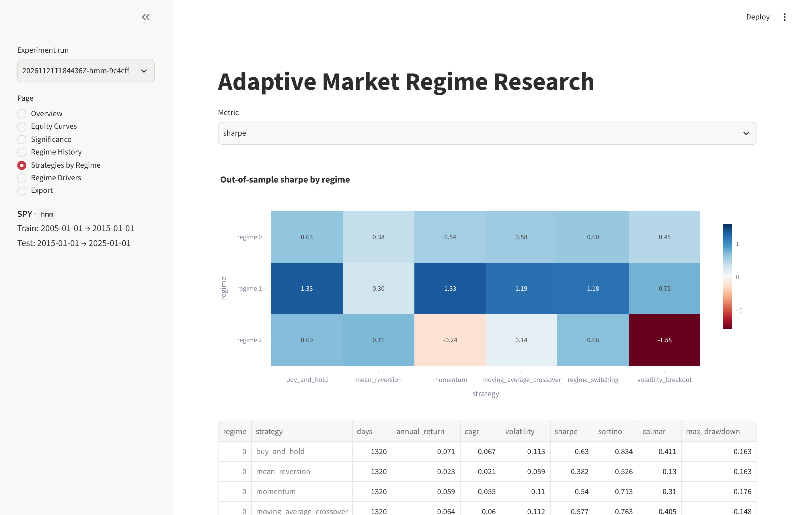

# Adaptive Market Regime Research

[](https://github.com/kayleewang07/adaptive-market-regime-research/actions/workflows/tests.yml)


Can knowing the market's "mood" improve a trading strategy? This project detects calm and
turbulent market regimes with unsupervised models, builds a strategy that adapts to the
regime, and tests it the way a quant researcher would: **out of sample, after trading
costs, with bootstrap confidence intervals, on six asset classes**.


## What it does

1. **Downloads** daily, dividend-adjusted prices from Yahoo Finance (cached locally as parquet)
   and validates them (no gaps, positive prices, consistent high/low).
2. **Builds 14 lagged features**: volatility, ATR, RSI, MACD, Bollinger z-score, moving-average
   distance, momentum, drawdown, return skew and kurtosis, volume z-score. Every feature for day
   *t* uses data up to *t − 1* only and is independent of the price level.
3. **Detects regimes** with one of four models, fitted on the training window only:

   | Model | How it labels a day |
   |---|---|
   | Gaussian HMM | forward-filtered state probabilities, `P(state_t \| x_1..x_t)` |
   | Gaussian mixture | most likely mixture component for that day's features |
   | K-Means | nearest centroid |
   | Bayesian online change-point ([Adams & MacKay, 2007](https://arxiv.org/abs/0710.3742)) | run-length posterior on daily returns; a new segment starts when a recent change is >90% likely |

   State models are renumbered so **regime 0 is the calmest** (by training-period volatility).
4. **Backtests five long-only strategies**: buy-and-hold, moving-average crossover, mean
   reversion, volatility breakout and time-series momentum. Every trade costs 7 bps
   (5 bps commission + 2 bps slippage). A position chosen at the close of day *t* earns
   the return from *t* to *t + 1*.
5. **Builds a regime-switching strategy.** For each regime it picks the strategy, or
   cash, with the best *training-period* Sharpe ratio, then follows that rule out of
   sample.
6. **Tests significance** with a stationary block bootstrap
   ([Politis & Romano, 1994](https://doi.org/10.1080/01621459.1994.10476870)): 95%
   confidence intervals for every Sharpe ratio, and a paired test of each strategy
   against buy-and-hold.
7. **Checks robustness** by running the same experiment on six assets: US large caps
   (SPY), tech (QQQ), small caps (IWM), international stocks (EFA), long-term Treasuries
   (TLT) and gold (GLD).
8. **Reports** Sharpe, Sortino, Calmar, CAGR, volatility and max drawdown, overall and
   per regime, plus regime transition probabilities and the features that best separate
   regimes (via a surrogate random forest), in an interactive Streamlit dashboard.

## Avoiding look-ahead bias

Backtests often look better than they should because information from the future leaks
into past decisions. This project guards against that in four places, and each one has a
test:

- **Features** are shifted by one day. A test changes prices from day *t* onward and
  checks that no feature before *t* changes.
- **Regime models** are fitted on `start → train_end` only and then frozen. A test
  changes test-period prices and checks that no training-period label changes.
- **HMM decoding** uses the forward filter, not Viterbi or forward-backward smoothing
  (hmmlearn's defaults), because those use the whole sequence. A test checks that
  changing later observations leaves earlier probabilities unchanged.
- **Strategies** only use prices up to the decision date. A test checks every strategy
  the same way.

## Results

The models were trained on 2005–2014. **Every number below covers 2015–2024**, which they
never saw, and includes trading costs. Reproduce with `amrrp run` and `amrrp study`.

### 1. The regimes are real and detected in time (SPY, HMM)

| Regime | Share of days | SPY annualized volatility | SPY annualized return |
|---|---|---|---|
| 0 calm | 52% | 11% | 7% |
| 1 normal | 30% | 16% | 21% |
| 2 turbulent | 17% | 31% | 22% |

States are persistent: the chance of staying in the same regime the next day is 94–98%.
The model switched to the turbulent state in the last week of February 2020, as the COVID
crash began, and the change-point model opened a new segment in the same week.

### 2. On SPY, trend-following breaks down in turbulent markets

Out-of-sample Sharpe ratio by regime, after costs:

| Regime | Buy & hold | Mean reversion | Momentum | MA crossover | Vol. breakout |
|---|---|---|---|---|---|
| 0 calm | 0.63 | 0.38 | 0.54 | 0.58 | 0.45 |
| 1 normal | 1.33 | 0.30 | 1.33 | 1.19 | 0.75 |
| 2 turbulent | 0.69 | **0.71** | **−0.24** | 0.14 | **−1.58** |

### 3. A regime-switching strategy doesn't beat buy-and-hold, and 10 years can't tell

Using training data only, the rule chose **buy-and-hold when calm, momentum when normal,
and mean reversion when turbulent**. Out of sample:

| SPY, 2015–2024 | Sharpe | 95% CI | Difference vs buy-and-hold [95% CI] | p-value | Max drawdown |
|---|---|---|---|---|---|
| Buy-and-hold | 0.78 | 0.23 to 1.45 | | | −34% |
| Regime switching | 0.72 | 0.15 to 1.37 | −0.06 [−0.37, +0.28] | 0.67 | −34% |
| MA crossover | 0.67 | 0.07 to 1.27 | −0.12 [−0.50, +0.24] | 0.50 | −22% |

Buy-and-hold's own Sharpe ratio is only known to within about **±0.6**. Ten years of
daily data can't separate strategies whose Sharpe ratios differ by 0.1, so a backtest
that reports one number without an interval overstates what it knows.



### 4. Six assets: the SPY finding doesn't fully generalize

`amrrp study` runs the same experiment on six assets (HMM regimes):

| Asset | Buy & hold Sharpe | Switching Sharpe | Difference [95% CI] | p | Max drawdown: B&H → switching | Trend Sharpe: calm → turbulent |
|---|---|---|---|---|---|---|
| SPY (US large caps) | 0.78 | 0.72 | −0.06 [−0.37, +0.28] | 0.67 | −34% → −34% | 0.56 → **−0.05** |
| QQQ (tech) | 0.88 | 0.81 | −0.07 [−0.41, +0.24] | 0.65 | −35% → −34% | 0.96 → **−0.34** |
| IWM (small caps) | 0.45 | 0.03 | −0.41 [−0.88, +0.04] | 0.08 | −41% → −39% | −0.12 → 0.43 |
| EFA (international) | 0.38 | 0.31 | −0.07 [−0.47, +0.36] | 0.74 | −34% → −24% | 0.00 → 0.35 |
| TLT (Treasuries) | 0.00 | 0.29 | +0.29 [−0.31, +0.87] | 0.36 | **−48% → −15%** | 0.24 → **−0.30** |
| GLD (gold) | 0.61 | 0.53 | −0.08 [−0.44, +0.28] | 0.64 | −22% → −17% | 0.50 → 1.11 |

"Trend Sharpe" is the average of momentum and MA crossover.

### What this shows

- **No significant edge.** Across 18 tests (6 assets × HMM, GMM and K-Means), regime
  switching never significantly beat buy-and-hold. One test was significant at the 5%
  level (K-Means on gold, where switching did *worse*), which is about what chance alone
  produces in 18 tests.
- **Real risk reduction.** Switching cut the maximum drawdown in 10 of the 12 HMM and GMM
  runs, most strongly on Treasuries (−48% to −15%) and international stocks (−34% to
  −24%). Its value is avoiding the worst losses, not raising returns.
- **Single-asset findings can mislead.** "Trend-following breaks down in turbulence"
  held for SPY, QQQ and TLT but reversed for small caps, international stocks and gold.
  Testing only on SPY would have overstated it.

**Limitations.** One ten-year test period; per-regime statistics stitch together
non-consecutive days; the 18 tests are not corrected for multiple comparisons; and the
switching rule is deliberately simple (one strategy per regime, chosen once).




## Quick start

Requires Python 3.11+.

```bash
git clone https://github.com/kayleewang07/adaptive-market-regime-research.git
cd adaptive-market-regime-research
python -m venv .venv && source .venv/bin/activate
pip install -e ".[dev]"
```

Run an experiment (downloads SPY on first use, then reads it from `data/cache/`):

```bash
amrrp run                       # uses configs/default.yaml
amrrp run --model gmm           # gmm | hmm | kmeans | bayesian_changepoint
amrrp run --symbol QQQ --config configs/default.yaml
```

Run the same experiment across several assets and get one summary table:

```bash
amrrp study                                 # SPY, QQQ, IWM, EFA, TLT, GLD
amrrp study --symbols SPY,TLT --model gmm
```

Open the dashboard:

```bash
amrrp dashboard
```

`python run_research.py` does the same as `amrrp run`.

### Configuration

Edit `configs/default.yaml` or make a copy:

```yaml
symbol: SPY
start: "2005-01-01"
train_end: "2015-01-01"   # models are fitted before this date only
end: "2025-01-01"
regime_model: hmm
n_regimes: 3
transaction_cost_bps: 5.0
slippage_bps: 2.0
strategies: [buy_and_hold, moving_average_crossover, mean_reversion, volatility_breakout, momentum]
```

Unknown keys, unknown model or strategy names, and impossible dates are rejected before
any work starts.

### Output

Each run writes a folder like `artifacts/20250101T120000Z-hmm-1a2b3c/` containing:

| File | Contents |
|---|---|
| `report.md` | readable summary of the run |
| `metrics_test.csv` / `metrics_train.csv` | strategy metrics, out-of-sample / in-sample |
| `sharpe_inference_test.csv` | Sharpe confidence intervals and tests vs buy-and-hold |
| `regime_metrics_test.csv` | strategy metrics within each regime |
| `regime_summary_test.csv` | how SPY behaved within each regime |
| `transition_matrix_test.csv` | one-day regime transition probabilities |
| `feature_importance.csv` | which features separate the regimes |
| `regimes.parquet`, `strategy_returns.parquet`, `prices.parquet` | raw series for the dashboard |
| `manifest.json` | full configuration and the regime-switching rule, so the run can be repeated |

`amrrp study` writes one such folder per asset, plus `study_summary.csv` and
`study_summary.md`.

## Development

```bash
pytest          # 56 tests; no network needed (they use synthetic prices)
ruff check .
mypy            # strict mode
```

```text
src/amrrp/
  data/            download, clean, validate, cache
  features/        lag-safe technical and statistical features
  regimes/         HMM, GMM, K-Means, Bayesian change-point
  strategies/      five baseline strategies + regime switching
  backtesting/     cost-aware daily backtest engine and metrics
  analytics/       per-regime comparisons, bootstrap inference
  explainability/  transition matrices, surrogate feature importance
  experiments/     config, train/test runner, multi-asset study
  reporting/       Markdown report and plots
  dashboard/       Streamlit app
  cli.py           `amrrp run` / `amrrp study` / `amrrp dashboard`
tests/             unit and end-to-end tests
```

## Next steps

- Walk-forward re-fitting (for example, yearly) to get many test periods instead of one.
- Size positions continuously from regime probabilities instead of switching outright.
- Add macro features (VIX, yield curve, credit spreads) to the regime models.
- Correct the cross-asset tests for multiple comparisons (for example, Benjamini–Hochberg).

## License

MIT. See [LICENSE](LICENSE).
