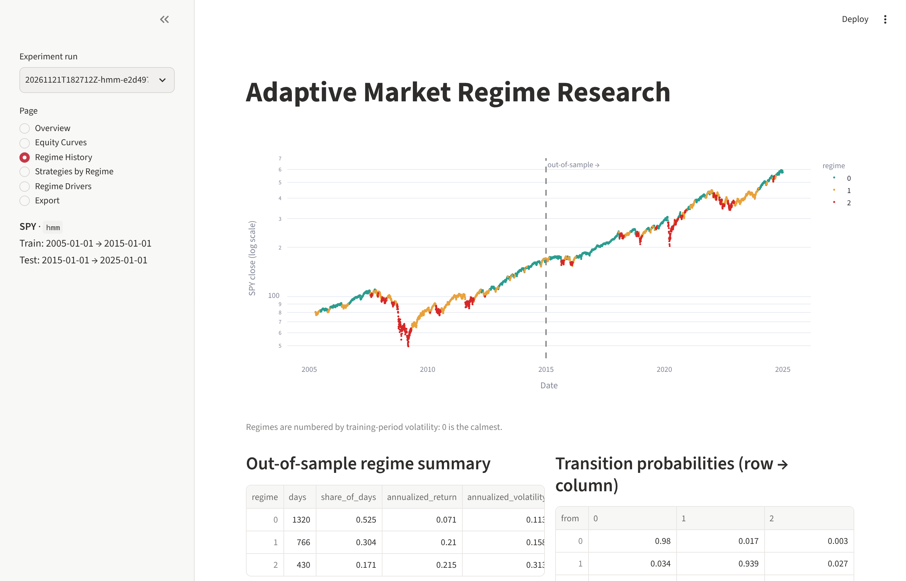
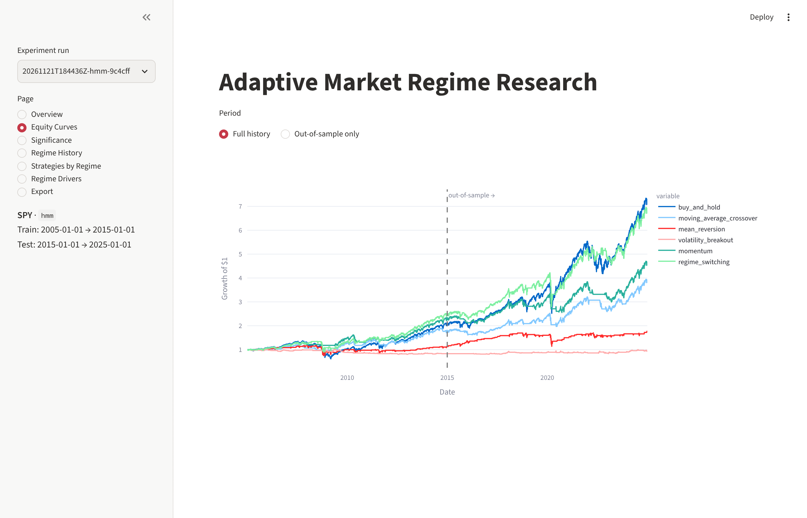

# Adaptive Market Regime Research

[](https://github.com/kayleewang07/adaptive-market-regime-research/actions/workflows/tests.yml)


Do simple trading strategies behave differently in calm and turbulent markets? This project
detects market regimes with unsupervised models and measures how five baseline strategies
perform in each regime, **using only out-of-sample data for every reported result**.



## What it does

1. **Downloads** daily, dividend-adjusted prices from Yahoo Finance (cached locally as parquet)
   and validates them (no gaps, positive prices, consistent high/low).
2. **Builds 14 lagged features**: volatility, ATR, RSI, MACD, Bollinger z-score, moving-average
   distance, momentum, drawdown, return skew and kurtosis, volume z-score. Every feature for day
   *t* uses data up to *t − 1* only and is independent of the price level.
3. **Detects regimes** with one of four models, fitted on the training window only:

   | Model | How it labels a day |
   |---|---|
   | Gaussian HMM | forward-filtered state probabilities, `P(state_t \| x_1..x_t)` |
   | Gaussian mixture | most likely mixture component for that day's features |
   | K-Means | nearest centroid |
   | Bayesian online change-point ([Adams & MacKay, 2007](https://arxiv.org/abs/0710.3742)) | run-length posterior on daily returns; a new segment starts when a recent change is >90% likely |

   State models are renumbered so **regime 0 is the calmest** (by training-period volatility).
4. **Backtests five long-only strategies**: buy-and-hold, moving-average crossover, mean
   reversion, volatility breakout and time-series momentum. Every trade costs 7 bps
   (5 bps commission + 2 bps slippage). A position chosen at the close of day *t* earns
   the return from *t* to *t + 1*.
5. **Reports** Sharpe, Sortino, Calmar, CAGR, volatility and max drawdown, overall and
   per regime, plus regime transition probabilities and the features that best separate
   regimes (via a surrogate random forest).
6. **Dashboard**: an interactive Streamlit app for browsing every run.

## Avoiding look-ahead bias

Backtests often look better than they should because information from the future leaks
into past decisions. This project guards against that in four places, and each one has a
test:

- **Features** are shifted by one day. A test changes prices from day *t* onward and
  checks that no feature before *t* changes.
- **Regime models** are fitted on `start → train_end` only and then frozen. A test
  changes test-period prices and checks that no training-period label changes.
- **HMM decoding** uses the forward filter, not Viterbi or forward-backward smoothing
  (hmmlearn's defaults), because those use the whole sequence. A test checks that
  changing later observations leaves earlier probabilities unchanged.
- **Strategies** only use prices up to the decision date. A test checks every strategy
  the same way.

## Results: SPY, 2005–2024

The models were trained on 2005–2014 and every number below covers **2015–2024**, which
they never saw. Produced by `amrrp run --model hmm` with the default config.

**What the HMM found (out of sample).** It turned the training data into three states:

| Regime | Share of days | SPY annualized volatility | SPY annualized return |
|---|---|---|---|
| 0 calm | 52% | 11% | 7% |
| 1 normal | 30% | 16% | 21% |
| 2 turbulent | 17% | 31% | 22% |

States are persistent: the chance of staying in the same regime the next day is 94–98%.
The model switched to the turbulent state in the last week of February 2020, as the COVID
crash began, and the change-point model opened a new segment in the same week.

**Sharpe ratio by regime (out of sample, after costs)**

| Regime | Buy & hold | Mean reversion | Momentum | MA crossover | Vol. breakout |
|---|---|---|---|---|---|
| 0 calm | 0.63 | 0.38 | 0.54 | 0.58 | 0.45 |
| 1 normal | 1.33 | 0.30 | 1.33 | 1.19 | 0.75 |
| 2 turbulent | 0.69 | **0.71** | **−0.24** | 0.14 | **−1.58** |

**Takeaways**

- **Trend-following stops working when markets are turbulent.** Momentum and MA
  crossover do well in normal markets but fall to a Sharpe of −0.24 and 0.14 in the
  turbulent regime, where they keep getting whipsawed.
- **Mean reversion is the only strategy that improves in turbulence** (0.71 vs 0.30
  to 0.38 elsewhere), because big dips that bounce back happen more often then.
- **Overall, buy-and-hold was hard to beat** in 2015–2024: Sharpe 0.78 vs 0.67 for the
  best timing strategy, though trend-following cut max drawdown from −34% to between −22% and −24%.

**Caveats.** This is one asset over one ten-year test period, so the per-regime numbers
rest on a few hundred days each and come with no significance tests. Regime metrics
stitch together days that aren't consecutive. The strategies don't use the regimes yet,
so these results show where a regime-switching strategy *might* add value, not that one
does.




## Quick start

Requires Python 3.11+.

```bash
git clone https://github.com/kayleewang07/adaptive-market-regime-research.git
cd adaptive-market-regime-research
python -m venv .venv && source .venv/bin/activate
pip install -e ".[dev]"
```

Run an experiment (downloads SPY on first use, then reads it from `data/cache/`):

```bash
amrrp run                       # uses configs/default.yaml
amrrp run --model gmm           # gmm | hmm | kmeans | bayesian_changepoint
amrrp run --symbol QQQ --config configs/default.yaml
```

Open the dashboard:

```bash
amrrp dashboard
```

`python run_research.py` does the same as `amrrp run`.

### Configuration

Edit `configs/default.yaml` or make a copy:

```yaml
symbol: SPY
start: "2005-01-01"
train_end: "2015-01-01"   # models are fitted before this date only
end: "2025-01-01"
regime_model: hmm
n_regimes: 3
transaction_cost_bps: 5.0
slippage_bps: 2.0
strategies: [buy_and_hold, moving_average_crossover, mean_reversion, volatility_breakout, momentum]
```

Unknown keys, unknown model or strategy names, and impossible dates are rejected before
any work starts.

### Output

Each run writes a folder like `artifacts/20250101T120000Z-hmm-1a2b3c/` containing:

| File | Contents |
|---|---|
| `report.md` | readable summary of the run |
| `metrics_test.csv` / `metrics_train.csv` | strategy metrics, out-of-sample / in-sample |
| `regime_metrics_test.csv` | strategy metrics within each regime |
| `regime_summary_test.csv` | how SPY behaved within each regime |
| `transition_matrix_test.csv` | one-day regime transition probabilities |
| `feature_importance.csv` | which features separate the regimes |
| `regimes.parquet`, `strategy_returns.parquet`, `prices.parquet` | raw series for the dashboard |
| `manifest.json` | full configuration, so the run can be repeated |

## Development

```bash
pytest          # 48 tests; no network needed (they use synthetic prices)
ruff check .
mypy            # strict mode
```

```text
src/amrrp/
  data/            download, clean, validate, cache
  features/        lag-safe technical and statistical features
  regimes/         HMM, GMM, K-Means, Bayesian change-point
  strategies/      five baseline strategies
  backtesting/     cost-aware daily backtest engine and metrics
  analytics/       per-strategy and per-regime comparisons
  explainability/  transition matrices, surrogate feature importance
  experiments/     config, train/test runner, run tracking
  reporting/       Markdown report and plots
  dashboard/       Streamlit app
  cli.py           `amrrp run` / `amrrp dashboard`
tests/             unit and end-to-end tests
```

## Next steps

- Regime-aware allocation: switch strategies based on the filtered regime, and test it
  out of sample.
- Walk-forward re-fitting (for example, yearly) with label alignment between re-fits.
- Multi-asset features (VIX, rates, credit spreads) and more tickers.
- Bootstrap confidence intervals for per-regime Sharpe ratios.

## License

MIT. See [LICENSE](LICENSE).
